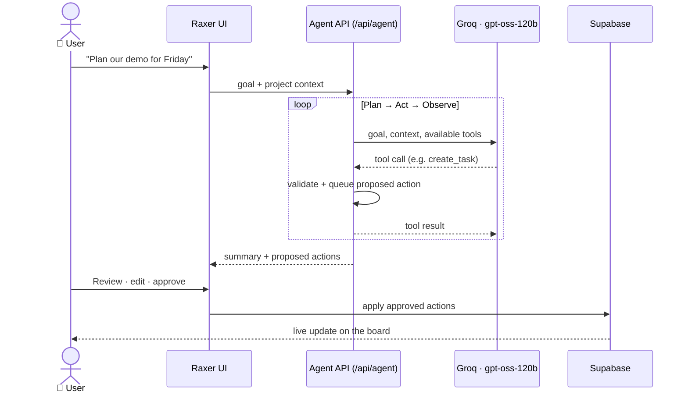
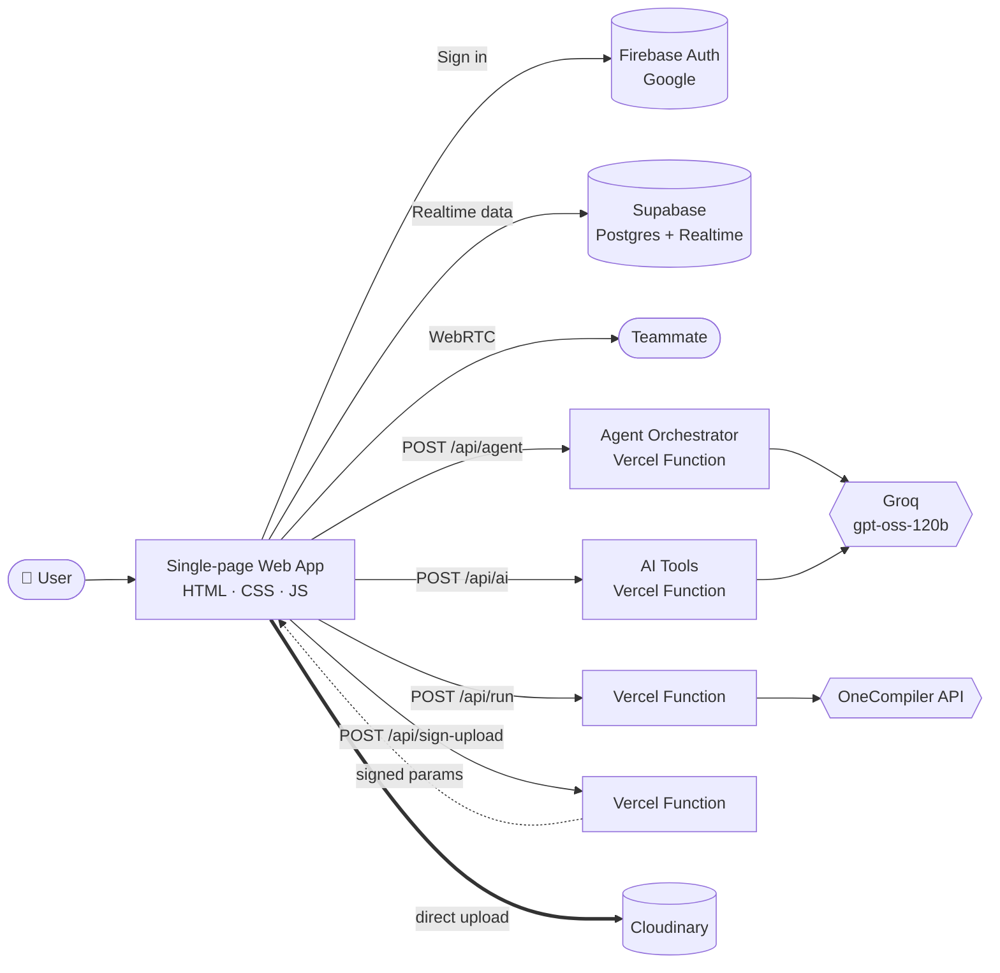

<div align="center">
    
# Raxer Project Management System
**An agentic AI workspace that plans, tracks and ships your projects with you.**

Tell Raxer your goal. Its agents break it into tasks, watch your deadlines, generate docs, slides and diagrams, and ask for your approval before changing anything.

<br/>

[](https://devpost.com/)
[](#-agentic-ai-in-raxer)
[](#-safety--human-control)
[](LICENSE)


[**🌐 Live Demo**](#) · [**🎬 Video Walkthrough**](#) · [**📝 Devpost Submission**](#) · [**🐞 Report a Bug**](../../issues)

</div>

---

## 📑 Table of Contents

- [💡 The Problem](#-the-problem)
- [✨ What Raxer Does](#-what-raxer-does)
- [🧠 Agentic AI in Raxer](#-agentic-ai-in-raxer)
- [🧩 Feature Cards](#-feature-cards)
- [🔁 How an Agent Run Works](#-how-an-agent-run-works)
- [🏗️ Architecture](#️-architecture)
- [🛠️ Tech Stack](#️-tech-stack)
- [📸 Screenshots](#-screenshots)
- [⚡ Getting Started](#-getting-started)
- [🔐 Environment Variables](#-environment-variables)
- [📁 Project Structure](#-project-structure)
- [🧪 Testing](#-testing)
- [⚠️ Limitations](#️-limitations)
- [🗺️ Roadmap](#️-roadmap)
- [📜 Credits & AI Disclosure](#-credits--ai-disclosure)
- [👥 Team](#-team)

---

## 💡 The Problem

Hackathon teams and student project groups juggle **a dozen disconnected tools**: a to-do app, a calendar, WhatsApp, Google Docs, a diagram tool, an online compiler and a file drive.

Nobody has time to *manage the project management tool*. Tasks go stale, deadlines slip, and the last 24 hours before a submission turn into chaos.

## ✨ What Raxer Does

**Raxer** is a single browser-based workspace for projects, deadlines, docs, code, files, chat and calls. Instead of just *storing* your plan, Raxer's AI agents **help build and maintain it**.

> **State the goal. Review the plan. Approve. Ship.**

| 🎓 Student teams | 🏆 Hackathon participants | 👨‍💻 Side-project builders | 🌍 Communities |
|:---:|:---:|:---:|:---:|
| Coordinate group work | Never miss a submission deadline | Keep tasks, code and docs together | Run forums and announcements |

---

## 🧠 Agentic AI in Raxer

Raxer is designed around **agents that plan, use tools and act on the workspace**, not a chatbot bolted on the side.

An agent in Raxer follows a **Plan → Act → Observe → Respond** loop. It reads your project context, chooses tools, sees the results, and continues until the goal is met. **Every change that writes to your workspace goes through your approval first.**

| Agent | Job | Tools it uses | Status |
|---|---|---|---|
| 🎯 **Planner Agent** | Turns a goal ("Ship our hackathon demo by Friday") into tasks, owners and due dates | read project context · create tasks · set deadlines · assign members | 🚧 In progress |
| ⏰ **Deadline Guard** | Spots at-risk work and proposes re-prioritization | read tasks · read deadlines · suggest changes | 🚧 In progress |
| 🗺️ **Diagram Agent** | Converts a plain-English description into an editable flowchart or system-architecture diagram | structured diagram generation (50+ node types) | ✅ Live |
| 📝 **Content Agent** | Writes, edits, shortens, summarizes and enhances text; auto-generates slides, notes and spreadsheet rows from topics | text generation tools inside the Docs / Slides / Sheets editors | ✅ Live |
| 🏁 **Submission Readiness Agent** | Checks a hackathon project against its checklist and lists what is missing | read tasks · read files · read docs | 🚧 In progress |

> **Why "agentic" and not just "AI features"?** A feature answers one prompt. An agent keeps a goal, picks tools, checks results and takes several steps, while a human stays in control of what actually changes.

---

## 🧩 Feature Cards

<table>
<tr>
<td width="33%" valign="top">

### 📊 Project Management
- Projects with *Active, Planning, Completed, Archived* status
- Task board with *To Do / In Progress / Done*
- **Workspaces** to group related projects
- Member roles and invites (including pending e-mail invites)
- Chart.js dashboards

</td>
<td width="33%" valign="top">

### ⏰ Deadlines & Calendar
- Dedicated **Deadlines** and **Calendar** screens
- All-tasks view across every project
- Inbox and notifications
- Built for hackathon and event timelines

</td>
<td width="33%" valign="top">

### 🤖 AI Writing Tools
- **Summarize · Write · Edit · Shorten · Describe · Enhance**
- Works in titles, bodies and selected spreadsheet cells
- Clean plain-text output, no preamble

</td>
</tr>
<tr>
<td width="33%" valign="top">

### 🗺️ AI Flowchart Designer
- Describe a workflow or system in plain English
- Get a structured, editable diagram
- **50+ shapes and architecture icons**: API, database, queue, cache, LLM, vector DB, CI/CD and more
- Drag, zoom, pan, connect, draw freehand

</td>
<td width="33%" valign="top">

### 📝 Built-in Editors
- **Docs**, **Sheets** and **Slides** inside the app
- **AutoGenerate** slides, notes and rows from topics
- Import `.docx` / `.xlsx`
- Export to **PDF, DOCX, PPTX, XLSX**

</td>
<td width="33%" valign="top">

### 💻 Dev Console
- Run code in **22 languages**
- Python, JavaScript, TypeScript, Java, C/C++, C#, Go, Rust, Kotlin, Swift and more
- Multiple file "stacks" per project
- Compiler key stays server-side

</td>
</tr>
<tr>
<td width="33%" valign="top">

### 📁 File Manager
- Folders, previews and downloads
- Signed direct uploads to Cloudinary (large files supported)
- PDF, Office, image and video handling

</td>
<td width="33%" valign="top">

### 💬 Chat & Calls
- Real-time **team chat** and direct messages
- **WebRTC voice/video calls**
- Messaging limited to people who share a project or community

</td>
<td width="33%" valign="top">

### 🏘️ Communities
- Forums and announcements
- Member management
- Membership enforced at the query level, not just in the UI

</td>
</tr>
<tr>
<td width="33%" valign="top">

### 🏅 Gamification
- Badges, streaks and a **leaderboard**
- AI-written profile overview from your task stats

</td>
<td width="33%" valign="top">

### 🛡️ Admin & Safety
- Admin dashboard with user and activity stats
- Approval flow for new users
- Block / unblock users
- Email visibility restricted to owner and admin

</td>
<td width="33%" valign="top">

### 🎨 Polished UX
- Light / dark mode and accent colors
- Responsive, from phone to desktop
- Skeleton loaders and live updates
- Customizable home widgets

</td>
</tr>
</table>

---

## 🔁 How an Agent Run Works



**Example**

| | |
|---|---|
| **Goal** | "We have a hackathon demo on Friday. Plan the remaining work." |
| **Agent reads** | open tasks, members, deadlines |
| **Agent proposes** | 6 new tasks with owners and dates, a deadline warning, and a draft architecture diagram |
| **You decide** | approve all, edit, or reject each item |

---

## 🏗️ Architecture



---

## 🛠️ Tech Stack

| Layer | Technology |
|---|---|
| **Frontend** | Vanilla HTML, CSS, JavaScript (single-page app, PWA-ready) |
| **Backend** | Vercel Serverless Functions (Node.js) |
| **AI** | Groq API · `openai/gpt-oss-120b` (chat completions, JSON mode, tool calling) |
| **Auth** | Firebase Authentication (Google sign-in) |
| **Database & Realtime** | Supabase (Postgres + Realtime) |
| **File storage** | Cloudinary (signed uploads) |
| **Code execution** | OneCompiler API |
| **Calls** | WebRTC |
| **Charts** | Chart.js |
| **Documents & export** | jsPDF · html2canvas · PptxGenJS · html-docx-js · SheetJS · Mammoth · JSZip |
| **Hosting** | Vercel |

---

## 🛡️ Safety & Human Control

- **Approval first:** agents *propose* changes; nothing is written to your workspace until you approve.
- **Server-side keys:** all AI, compiler and storage secrets stay in serverless functions, never in the browser.
- **Constrained outputs:** diagram generation is limited to a whitelist of node types, and the output is validated before it is drawn.
- **Scoped data:** agents only receive the context of the project you opened.
- **Access control:** membership rules limit who can see projects, chats and communities.

---

## 📸 Screenshots

> Replace these with real screenshots (save them in `docs/screenshots/`).

| Dashboard | Agent Plan Review |
|:---:|:---:|
|  |  |

| AI Flowchart | Dev Console |
|:---:|:---:|
|  |  |

| Docs / Slides Editor | Team Chat & Calls |
|:---:|:---:|
|  |  |

🎬 **Demo video:** _add your link here_

---

## ⚡ Getting Started

### Prerequisites
- [Node.js](https://nodejs.org/) 18+
- [Vercel CLI](https://vercel.com/docs/cli): `npm i -g vercel`
- Accounts for **Groq**, **Firebase**, **Supabase**, **Cloudinary** and **OneCompiler**

### Run locally

```bash
git clone https://github.com/YOUR_USERNAME/raxer.git
cd raxer

# add the environment variables below, then:
vercel dev
```

Open **http://localhost:3000**.

### Deploy

```bash
vercel --prod
```

Add the environment variables in **Vercel → Project Settings → Environment Variables**, then redeploy.

---

## 🔐 Environment Variables

| Variable | Used by | Purpose |
|---|---|---|
| `GROQ_API_KEY` | `api/ai.js`, `api/agent.js` | Groq access for all AI features |
| `onecompiler_api_key` | `api/run.js` | Code execution in the Dev Console |
| `CLOUDINARY_CLOUD_NAME` | upload / sign / delete functions | Your Cloudinary cloud |
| `CLOUDINARY_API_KEY` | upload / sign / delete functions | Cloudinary signing |
| `CLOUDINARY_API_SECRET` | upload / sign / delete functions | Cloudinary signing |

> ⚠️ **Never commit API keys or secrets.**

---

## 📁 Project Structure

```text
raxer/
├── api/
│   ├── agent.js         # Agent orchestrator: plan → act → observe loop (in progress)
│   ├── ai.js            # AI tools: writing actions + flowchart generation
│   ├── run.js           # Code execution proxy (OneCompiler)
│   ├── upload.js        # Server-side Cloudinary upload
│   ├── sign-upload.js   # Signed params for direct browser uploads
│   └── delete-file.js   # Signed Cloudinary delete
├── index.html           # Single-page app (UI, state, editors, realtime)
├── LICENSE
└── README.md
```

---

## 🧪 Testing

| Area | How it was tested | Result |
|---|---|---|
| AI writing tools | Each action run on sample text of different lengths | ✅ Clean plain-text output |
| Flowchart generation | Workflow and system descriptions | ✅ Valid JSON that renders on the canvas |
| Code execution | Snippets in several languages | ✅ Output and errors shown |
| File upload / delete | PDF, Office, image and larger files | ✅ Signed upload and cleanup work |
| Real-time sync | Two browser sessions on one project | ✅ Changes appear live |
| Agent planning | _add: sample goals, number of runs, how many proposals were usable_ | 🚧 _fill in_ |

> Replace the placeholder row and confirm the other results with your own runs before submitting.

---

## ⚠️ Limitations

- **AI can be wrong.** Review generated text, plans and diagrams. Vague goals produce vague plans, and very long descriptions can give cluttered flowcharts.
- **Agents propose, humans decide.** Agent runs are capped to a small number of steps to control cost and avoid loops.
- **Output limits.** Text responses are capped (1024 tokens) and flowcharts (2048 tokens), so long documents may be cut off.
- **Third-party quotas.** AI, code execution and storage depend on free-tier limits of Groq, OneCompiler and Cloudinary.
- **Online only.** Offline editing is not supported.
- **Calls.** WebRTC can fail behind strict firewalls without a TURN server.
- **Single-file frontend.** Quick to ship, harder to maintain.

---

## 🗺️ Roadmap

- [ ] Agent Orchestrator with tool calling and approval UI
- [ ] Planner, Deadline Guard and Submission Readiness agents
- [ ] Agent memory per project
- [ ] Calendar sync (Google / iCal)
- [ ] Modular frontend with automated tests
- [ ] Installable PWA with offline support

---

## 📜 Credits & AI Disclosure

**AI in the product:** Groq-hosted `openai/gpt-oss-120b`.

**Open-source libraries:** Chart.js, SheetJS, Mammoth, jsPDF, html2canvas, PptxGenJS, html-docx-js, JSZip, Supabase JS, Firebase JS SDK.

**Services:** Groq, Firebase, Supabase, Cloudinary, OneCompiler, Vercel.

**Pre-existing vs. built during the event:** _list what existed before AI OpenBuild and what was added during it._

**AI assistance in development:** _state which tools (if any) helped write code or docs._

---

## 👥 Team

| Name | Role |
|---|---|
| **Piyush Rajesh Deshkar** | Developer / Project Lead |

_Add teammates here (up to five)._

---

## 📄 License

Distributed under the **MIT License**. See [`LICENSE`](LICENSE).

<div align="center">

Built for **AI OpenBuild**

⭐ Star the repo if Raxer helps your team ship!

</div>
